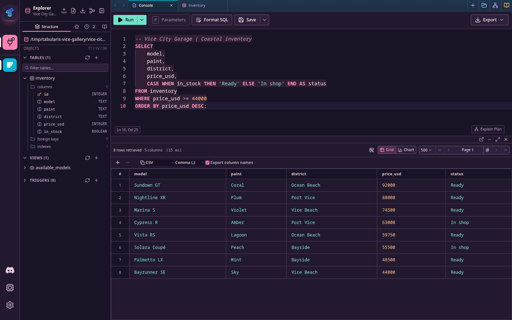
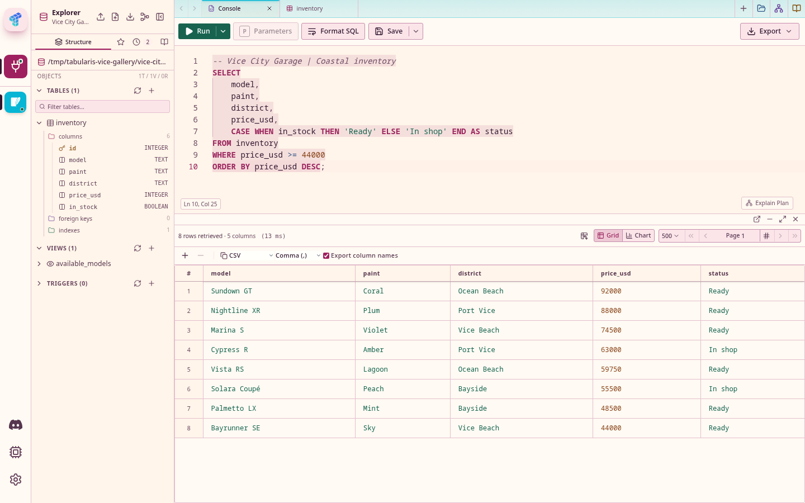

# Vice City for Tabularis

An unofficial GTA VI–inspired theme for Tabularis. **After Dark** puts coral pink,
coastal mint, and peach over a deep plum canvas. **Daybreak** keeps the warm
peach and rose palette with ink-purple text for daylight. Both variants color
the interface, SQL syntax, result values, keys, and status indicators.

The palette takes its sunset tones from [Rockstar's GTA VI artwork](https://www.rockstargames.com/VI/media)
and its plum, mint, and coral from the Tabularis clips *SQL Drift*, *Fast Lane*,
and *Production Checkpoint*. The palette is original. No Rockstar images, logos,
or fonts are bundled.

## Install

In Tabularis Web, open **Settings → Appearance → Browse themes in Plugins**,
then find and install **Vice City for Tabularis**. Open **Appearance** and pick
**Vice City After Dark** or **Vice City Daybreak**. Set the editor theme to
**Same as App** for matching SQL syntax colors, and enable result colors by type
to show the grid palette.

For offline installation, use **Appearance → Import theme → Local package**
with the [release ZIP](https://github.com/TabularisDB/tabularis-vice-city-theme/releases/latest/download/theme-universal.zip).
The package format requires Tabularis 0.26.0 or newer. Tabularis Web is the
recommended installation target. On Linux desktop 0.33.0, the frontend's Content
Security Policy blocks theme validation and Tabularis falls back to a built-in
theme.

The screenshots use a synthetic SQLite garage inventory.

## Screenshots

[Theme selection in Tabularis](screenshots/vice-city-appearance.png)

## Optional animated Web preview

The local Web preview adds a tropical panorama to Connections, the SQL console,
and table tabs. A small SVG car crosses the workspace panorama and stays parked
when the browser requests reduced motion.

| Variant | Connections | Console | Table |
| --- | --- | --- | --- |
| After Dark | [Sunset](screenshots/vice-city-after-dark-connections-preview.png) | [SQL console](screenshots/vice-city-after-dark-console-preview.png) | [Inventory](screenshots/vice-city-after-dark-table-preview.png) |
| Daybreak | [Sunrise](screenshots/vice-city-daybreak-connections-preview.png) | [SQL console](screenshots/vice-city-daybreak-console-preview.png) | [Inventory](screenshots/vice-city-daybreak-table-preview.png) |

To use it with a local Tabularis Web 0.32 build, copy `web-preview/` to the web
root and load `/web-preview/after-dark.css` with a stylesheet link in the
local `index.html`. Load `/web-preview/drive.js` with a deferred script tag to
enable Play. Use Space or Up to jump over cones, barrels, barricades, and spike
strips. Use Left and Right to steer and Escape to leave. Clearing obstacles and
collecting star pickups fills the heat meter toward the next wanted star. Each
level increases road speed and pursuit pressure, shortens the time between
shots, and puts obstacles closer together. A second patrol joins at two stars,
a helicopter and crates join at four, and armored roadblocks appear at six.

Hits let the patrol close the gap. Shields block one hit, and pulse pickups
reload your shots. Jump over patrol shots and press X to fire a pulse backward.
When WASTED appears, click Retry or press Space to start again.

The CSS uses the English Connections view and the 0.32 DOM
structure. The registry ZIP contains the two native color themes. The panoramas
and animation require the separate stylesheet.
